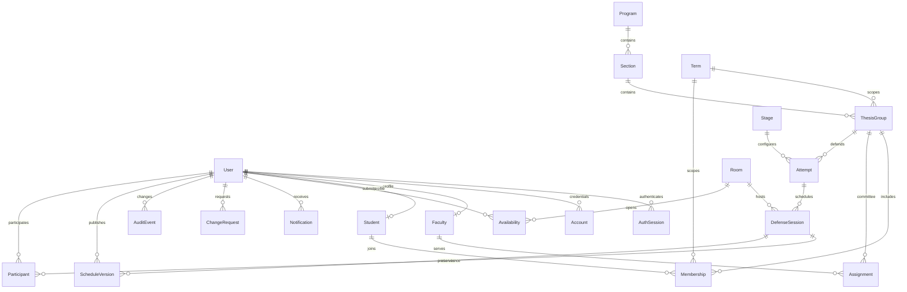

# Architecture and data relationships

This is one college per database. All dates and time-only availability values are college-local Asia/Manila values. Session instants are converted with `date-fns-tz` to UTC before persistence, and converted back for display, workload dates and ISO weeks, PDFs and CSV. PostgreSQL timestamp values are interpreted as UTC by Prisma. Never parse a college date using the server's local timezone.

`College` and `Rules` are singleton configuration rows. `AuditEvent` stores actor, action, timestamp and details. There is no grading, manuscript storage, plagiarism service, auto-panel matching or external messaging.

## Scheduling algorithm

1. Select term, stage, date range, room set, and optional attempts.
2. Retain all published/completed reservations and locked drafts. Replace only unlocked drafts in the selection.
3. Sort attempts by approved priority descending, readiness date ascending, then stable group code and attempt ID.
4. Scan dates ascending, start times in 15-minute increments, then room IDs ascending. Choose the first interval accepted by the shared validator. Add the proposal to the in-memory working set before checking the next group.
5. Stop at 20,000 candidate checks per generation. Persist unscheduled explanations. Search exhaustion is explicitly labeled as no slot found within the limit.

This deterministic first-fit heuristic is understandable and bounded. It does not prove infeasibility, optimize fairness, select committees, or backtrack to improve packing. Earlier placements can prevent a later group from fitting. Expanding dates, adding availability, or scheduling smaller batches can help. Preference requests are reviewed by a human; they do not override hard constraints or automatically alter priorities.

The same `validate` function runs during generation, manual edit, publication, and rescheduling. Availability includes defense plus turnover time. Adjacent available intervals are merged; date-specific positive windows replace weekly positive windows for that date; any applicable block overrides both. Missing availability is never treated as free. Calendar days and ISO weeks follow Manila. A chair is a panelist and counts only once in attendance. Completed sessions count toward past workload; cancelled sessions release it. Advising capacity only limits new assignments and student additions, never defense attendance for an existing advisee.

## Concurrency and publication

Every application scheduling, availability, committee, capacity and membership mutation enters a PostgreSQL transaction and obtains the same transaction-scoped advisory lock (`724501`) **before** reading constraint data. READ COMMITTED ensures the transaction reads the last committer's data after the lock is granted. This intentionally serializes mutations for a modest single-college workload. Publication checks its batch against real reservations and other sessions in the batch; unrelated drafts are proposals and reserve nothing. A later contender sees the committed winner and receives a conflict response.

Partial unique indexes protect active membership within student/course/term and one non-cancelled booking per defense attempt. Foreign keys and SQL checks guard record integrity. The advisory lock is an application protocol: direct database scripts must follow it. Run seed/verifiers only in an isolated fictional demo database. For a larger multi-college service, use narrower resource locks and database reservation/exclusion tables after profiling.

Drafts do not create official notifications or versions. Publication creates version 1, current snapshots, attendance rows, notifications and audit entries in one transaction. Rescheduling validates the replacement while excluding only the old reservation, retains version history, increments the version and notifies old and new participants. An availability or rule change revalidates published sessions and flags conflicts without moving/releasing their reservations. A coordinator must explicitly resolve them.

## Authentication, authorization and reports

Better Auth handles credential hashing/session cookies; public signup is disabled. Coordinator-created users receive a temporary password. Role is stored server-side and cannot be supplied at signup. Every mutation checks the actor's role or record ownership. The application endpoint checks same-origin mutation requests; Better Auth performs its own origin/cookie protections. Production requires HTTPS and a unique random auth secret.

Students see only their groups and sessions where they are recorded participants. Faculty see assigned groups and their own official sessions. Reports independently recheck scope; hiding a button never grants security. Exports use published snapshots so later roster or room edits do not rewrite historical PDFs. A version filter selects a per-session published version (not a college-wide release number). Unscheduled explanations stay on the waiting screen and are not mixed into official report rows. CSV has one row per student and neutralizes formula prefixes.

PDF uses React PDF's wrapping engine with repeated headers and page footers. Long titles and member lists can continue across pages. No remote fonts or paid APIs are required.

## Deliberate first-version boundaries

- All individual students in a group may submit permitted requests and availability; there is no separate representative election workflow.
- Users and groups can be created; student identifiers/names/email, thesis details, approved faculty limits, room details, rules, availability and assignments are editable. Coordinators can reset a student's temporary password, invalidating their sessions. Self-service account recovery, password rotation, and bulk CSV import are extensions.
- Preferred date/time/room and capacity requests are stored and can be resolved/declined. Coordinator must make the actual approved change separately.
- Group rosters use names, identifiers and shared session details. Sessions preserve historical participant names; current group pages show current members.
- The UI provides a weekly availability strip and dated defense agenda; drag-and-drop calendar editing is outside this version.
- College logo can be configured by placing an asset in `public/` and changing its path in Settings.
